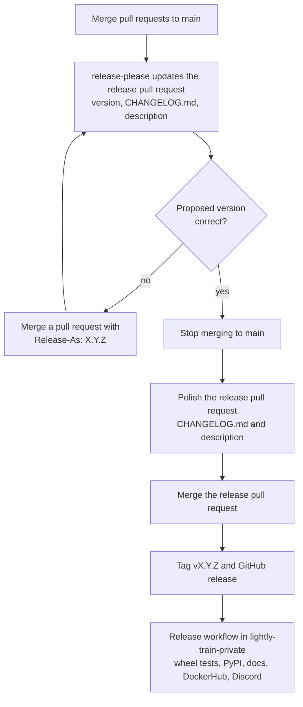

# Releasing LightlyTrain

Releases are automated with
[release-please](https://github.com/googleapis/release-please). Every release follows
the same steps. Only the version and the amount of polishing differ.

## 1. Release Pull Request

Every push to `main` runs [release.yml](./.github/workflows/release.yml). release-please
keeps one release pull request `chore(release): LightlyTrain X.Y.Z` open and regenerates
it on every merge:

- Bumps `__version__` in `src/lightly_train/__init__.py`.
- Adds a section for `X.Y.Z` to [CHANGELOG.md](./CHANGELOG.md) from the pull request
  titles.
- Writes the same section into the pull request description.

No action needed.

## 2. Choose the Version (Optional)

Skip this step if the version in the release pull request title is the one you want. See
[Version Bumps](#version-bumps) for how the version is proposed.

To set a different version, for example `0.19.0`:

1. Merge any pull request to `main` with `Release-As: 0.19.0` as the last line of the
   squash commit message in the merge dialog, on its own line and without a leading `*`.
1. Wait until the release pull request title shows `0.19.0`.

`Release-As` applies only to the next release.

## 3. Polish and Merge

> **This is the last step before the release goes out.** release-please regenerates the
> release pull request on every merge to `main` and discards all manual edits.
>
> - Announce the release in `#dev-train-discuss` and stop merging to `main`.
> - Polish, then merge the release pull request right away.
> - If something was merged to `main` in the meantime, redo the polishing.

> **Edit both CHANGELOG.md and the pull request description.** The GitHub release notes
> and the Discord message come from the description, not from CHANGELOG.md.

1. Push a commit to the release pull request branch:
   - Rewrite the `X.Y.Z` section of [CHANGELOG.md](./CHANGELOG.md) for users. For
     example group entries, merge related ones, or add a highlights paragraph.
   - Keep the `## [X.Y.Z](...) (YYYY-MM-DD)` header. The docs build depends on it.
   - Optional: add a "News" entry to [README.md](./README.md) and
     [docs/source/index.md](./docs/source/index.md).
1. Edit the release pull request description:
   - Replace the text below the `## [X.Y.Z](...) (YYYY-MM-DD)` header with the rewritten
     section.
   - Keep the header and both `---` lines. Otherwise release-please creates no release.
   - Discord shows the text up to `<!-- STOP DISCORD MESSAGE -->`, at most 4096
     characters.
1. Wait for CI and merge the release pull request.

Merging creates the `vX.Y.Z` tag and the GitHub release, and starts the
[Release](https://github.com/lightly-ai/lightly-train-private/actions/workflows/release.yml)
workflow in `lightly-train-private`:

1. Validates that the tag is a published `vX.Y.Z` release.
1. Builds the wheel, runs the quick unit tests on it with the pinned dependencies and
   publishes exactly that wheel to PyPI. Skipped if the version is already on PyPI.
1. Publishes the documentation and the DockerHub image in parallel.
1. Runs the quick unit tests against the package on PyPI with the latest dependencies.
1. Posts to Discord and to the `#releases` Slack channel.

The full unit tests on GPU are not part of the release. They run nightly in
`lightly-train-private`.

## 4. After the Release

- [ ] Check `#releases` on Slack for success of all steps.
- [ ] If [README.md](./README.md) changed since the last release, update the
  [DockerHub description](https://hub.docker.com/r/lightly/). Requires a member of the
  Lightly DockerHub organization.
- [ ] Resume merging to `main` and announce it in `#dev-train-discuss`.

## Version Bumps

The pull request titles since the last release decide whether a release pull request
opens and which version it proposes. The largest bump wins.

| Type                                | Changelog section | Opens a release | Bump below 1.0.0 |
| ----------------------------------- | ----------------- | --------------- | ---------------- |
| `feat`                              | Added             | yes             | patch            |
| `fix`                               | Fixed             | yes             | patch            |
| `perf`, `revert`                    | Changed           | yes             | patch            |
| `refactor`, `docs`, `test`, `build` | hidden            | no              | none             |
| `ci`, `chore`                       | hidden            | no              | none             |
| any type with `!`                   | Breaking Changes  | yes             | minor            |
| `Release-As: X.Y.Z`                 | none              | yes             | `X.Y.Z`          |

- Hidden types still ship with the next release. They are only not listed.
- User-facing dependency changes, for example a higher minimum version, use `fix(deps):`
  or `feat!:`, not `build:`.
- From `1.0.0` on, `!` bumps the major version and `feat` the minor version.

## Failures

The tag and the GitHub release exist before the wheel tests run. A failed release leaves
them in place. Announce failures in `#dev-train-discuss`. Never publish code to PyPI or
DockerHub that differs from a GitHub release.

- **Wheel tests fail:** nothing is published. Fix forward on `main` and release the next
  version.
- **Tests against PyPI fail:** the release is already public. Usually a new upstream
  release broke LightlyTrain. Cap the dependency or fix the code and release the next
  version.
- **Infrastructure failure:** rerun
  [Release](https://github.com/lightly-ai/lightly-train-private/actions/workflows/release.yml)
  via `workflow_dispatch` with the tag. Steps that are already done are safe to repeat.

The full runbook, including documentation-only fixes, is `RELEASE.md` in
`lightly-train-private`.

## Configuration

- [release-please-config.json](./release-please-config.json): changelog sections and
  release pull request text.
- [.release-please-manifest.json](./.release-please-manifest.json): current version.
  Updated by release-please.
- Lightly Release Bot: GitHub App installed on `lightly-train` and
  `lightly-train-private` with read and write access to contents, issues and pull
  requests. `RELEASE_APP_ID` (variable) and `RELEASE_APP_PRIVATE_KEY` (secret) are
  stored in the `release` environment of this repository.
